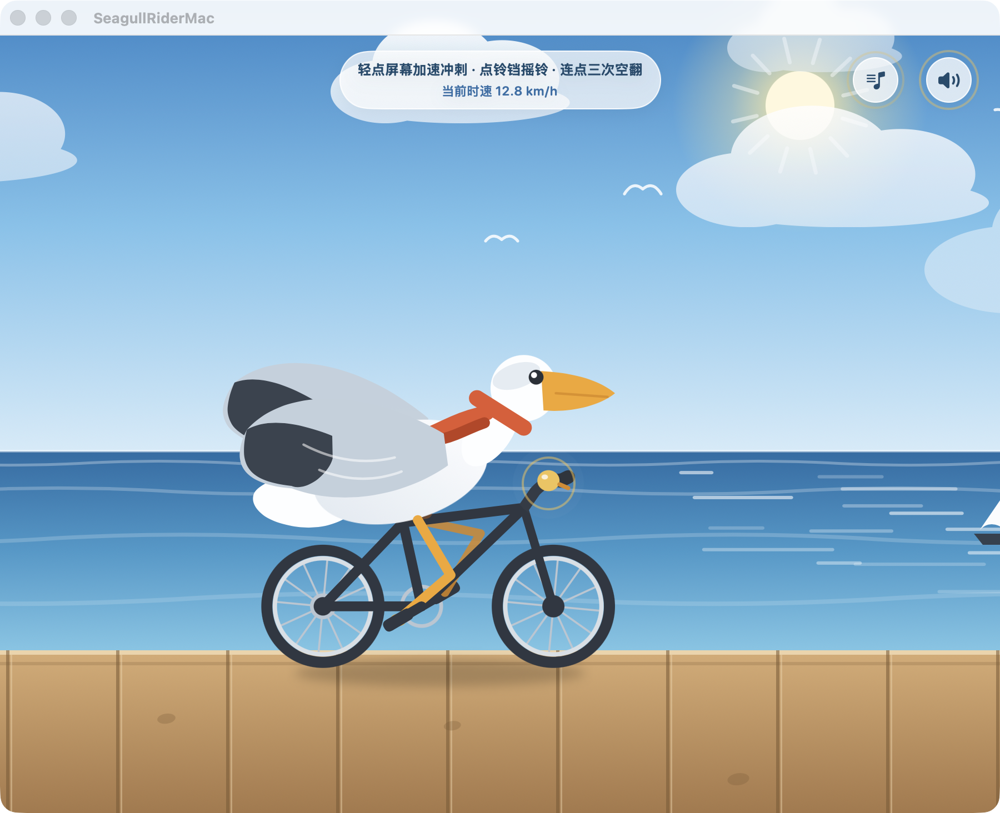
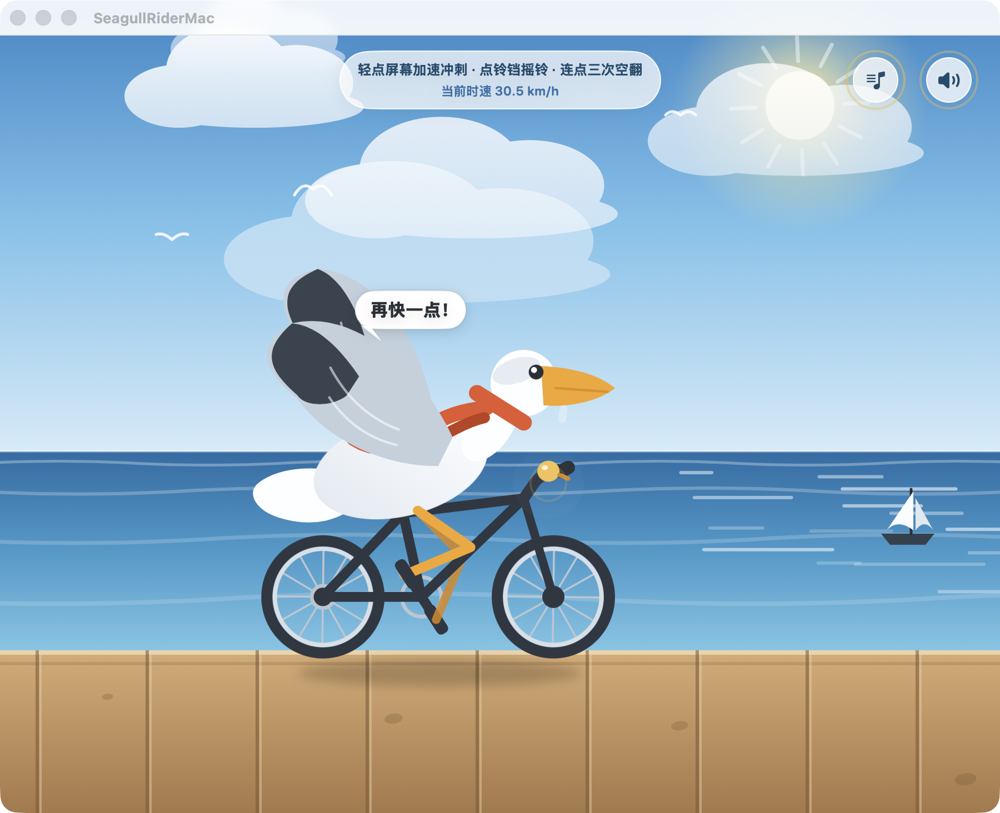
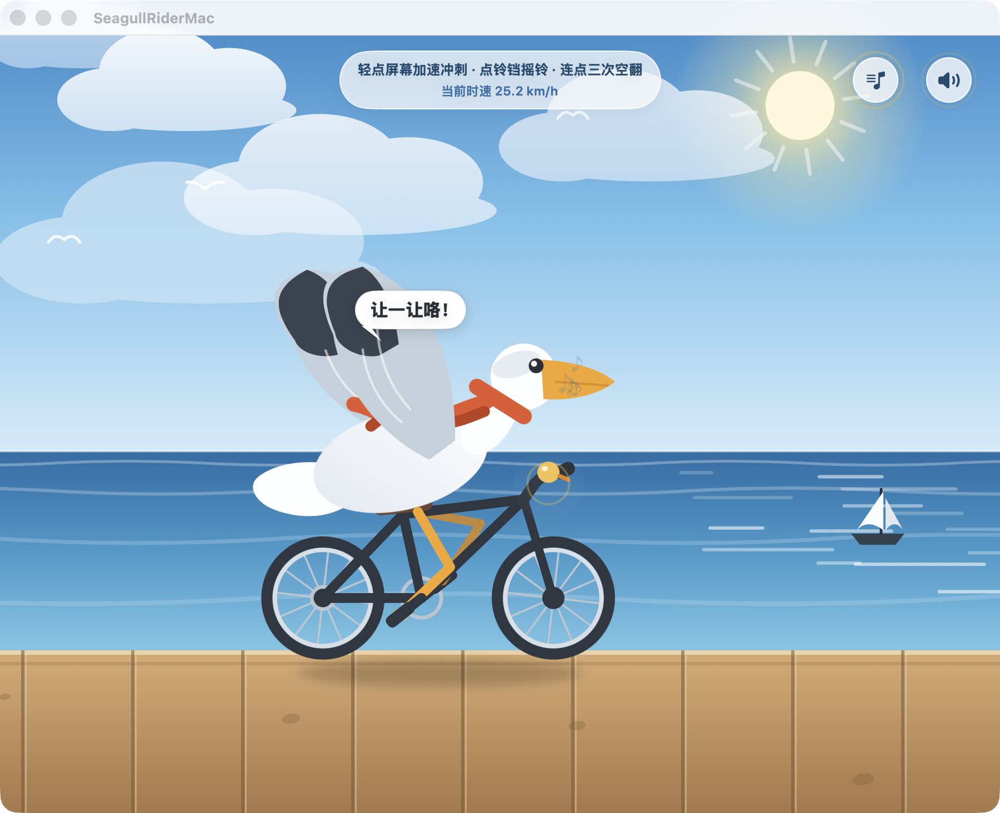

# 海鸥骑自行车 🐦🚲🌊

一只海鸥骑着自行车，沿着海边栈道迎风骑行。用 SwiftUI 写的小游戏 / 互动动画，
所有画面全部由代码绘制，所有声音全部由数学波形实时合成——**仓库里没有任何图片和音频素材文件**。

## 玩法

| 操作 | 效果 |
| --- | --- |
| 轻点屏幕 | 冲刺加速，海鸥张开翅膀，冒出台词气泡 |
| 连点三次 | 触发空中空翻特技，落地时扬起火花 |
| 点车铃 | 叮铃铃～摇铃让路，飘出音符 |
| 右上角 🔊 | 总声音开关（音效 + 环境音 + 音乐） |
| 右上角 ♪ | 背景音乐独立开关 |

## 特性

- **纯代码画面**：天空、云、海浪、帆船、海鸥、自行车全部是 SwiftUI 矢量绘制，随窗口/设备尺寸自适应
- **程序合成音效**：基于 AVAudioEngine 实时合成车铃、海鸥叫、冲刺风声、空翻、落地、振翅六种音效，音色经过柔化处理，不刺耳
- **合成背景音乐**：C–Am–F–G 和弦进行的 8 秒无缝循环小曲（低音 + 微失谐垫音 + 柔和拨弦），同样零音频文件
- **海浪环境音**：4 秒无缝循环，营造海边氛围
- **触感反馈**：不同力度的 Haptics（iOS 真机）
- **生命周期友好**：退到后台自动停掉所有长音，回到前台按各开关状态恢复

## 运行

用 [Swift Playgrounds](https://www.apple.com/swift-playgrounds/)（iPad 或 Mac）打开 `我的 App.swiftpm`，点运行即可。

- 平台要求：iPadOS / iOS 26.0+
- 支持竖屏与横屏（iPad 亦支持四向）

## 代码结构

| 文件 | 职责 |
| --- | --- |
| `MyApp.swift` | App 入口 |
| `ContentView.swift` | 主界面布局与手势 |
| `RideModel.swift` | 骑行状态机：速度、空翻、台词、粒子 |
| `SeagullRider.swift` | 海鸥与单车的矢量绘制 |
| `SceneLayers.swift` / `SceneShapes.swift` | 天空 / 海面 / 栈道等场景图层 |
| `EffectLayers.swift` | 速度线、粒子、气泡、声音/音乐开关按钮 |
| `RigShapes.swift` | 角色骨架的关键点定义 |
| `SoundKit.swift` | 音频引擎：音效合成、海浪环境音、背景音乐 |
| `Theme.swift` | 配色与通用小工具 |

## License

仅供学习交流使用。
